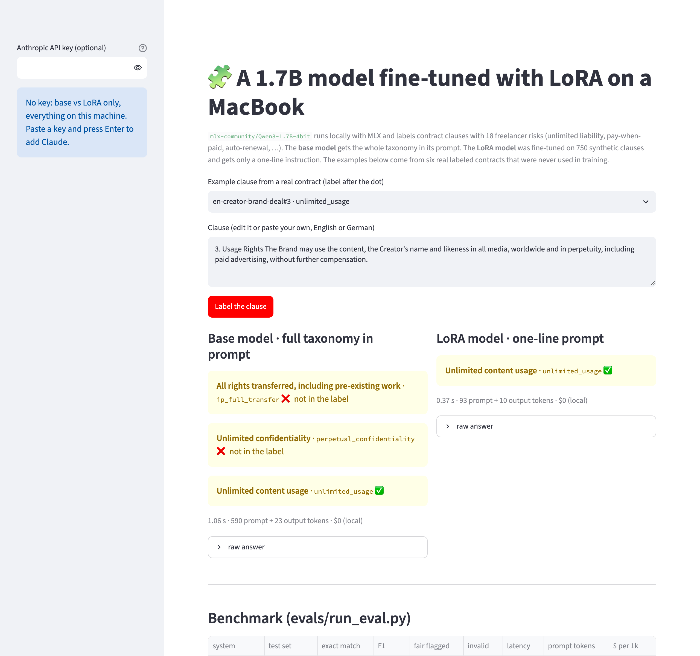
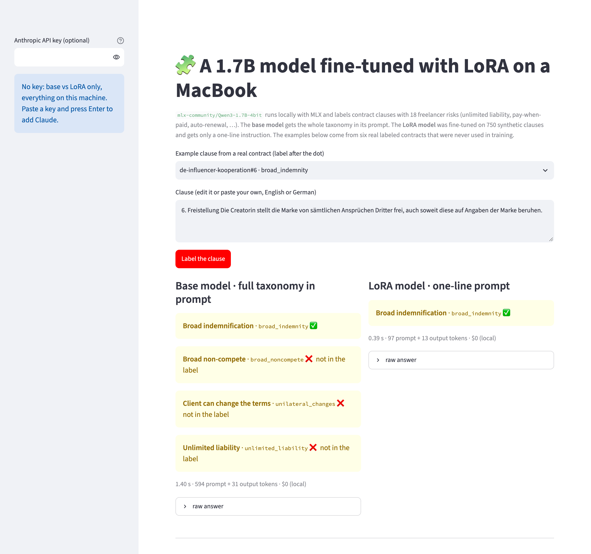
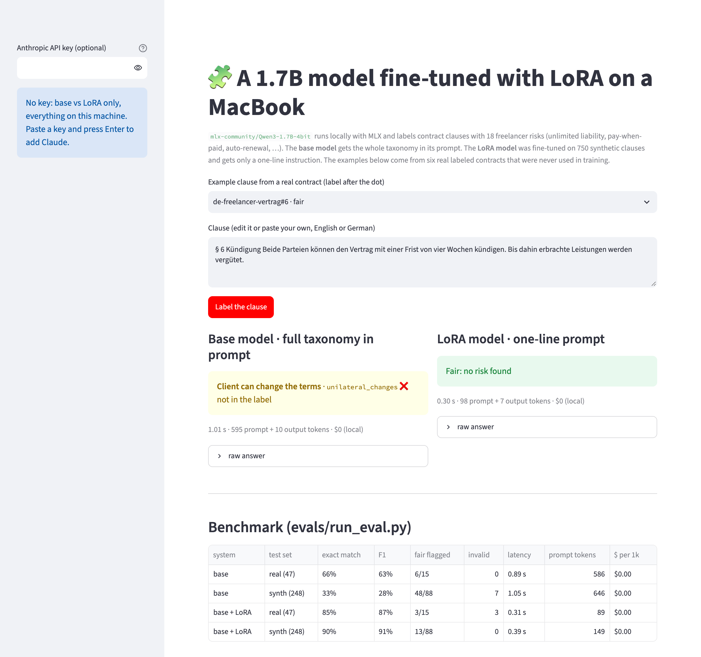

# lora-clauses

**LoRA fine-tuning of a small open model on a MacBook**, with [MLX-LM](https://github.com/ml-explore/mlx-lm). A
1.7B model (`mlx-community/Qwen3-1.7B-4bit`) learns to label contract clauses with 18 risks a freelancer should
know about (unlimited liability, pay-when-paid, auto-renewal, a portfolio ban, …), in English and German. It is
then benchmarked against the **base model** and against **Claude** (`claude-opus-5-5`) on quality, cost per 1,000
requests and speed.

Everything runs on one MacBook Pro M1 Pro with 16 GB: training took **26 minutes**, the adapter is 20 MB, and the
fine-tuned model answers in about **0.3 s per clause at no API cost**. The training data is **739 synthetic
clauses written by Claude** ($4 in API fees). The main test set is **47 clauses from six real, hand-labeled
contracts** (from the [contract-red-flags](https://github.com/ExNNeph/contract-red-flags) repo) that were never
used for training or shown to Claude when it wrote the data.

| on the 47 real clauses | exact match | F1 | fair clauses wrongly flagged | latency | prompt tokens | $ per 1k clauses |
|---|---|---|---|---|---|---|
| base Qwen3-1.7B (taxonomy in the prompt) | 66% | 63% | 6 / 15 | 0.89 s | 586 | $0 |
| **base + LoRA adapter** (one-line prompt) | **85%** | **87%** | 3 / 15 | **0.31 s** | **89** | **$0** |
| Claude `claude-opus-5-5` (taxonomy in the prompt) | 98% | 99% | 1 / 15 | 1.46 s | 1,277 | $5.43 |

All numbers, including the 248-clause synthetic test set, are under [Results](#results).

## Preview

**One clause, two models.** The base model gets the whole taxonomy in its prompt and still flags three extra
risks on this usage-rights clause. The LoRA model only gets a one-line instruction and names the one risk in the
label, in a third of the time:



**German works too.** A one-sided indemnity in a German influencer contract. The base model adds a non-compete,
unilateral changes and unlimited liability, none of which are in the clause:



**Fair clauses stay fair.** Many clauses only *talk about* a risky topic. Here both parties may terminate with
four weeks' notice and work done is paid; the base model still sees "client can change the terms". The training
data has fair "near misses" for every risk, so the LoRA model learned the difference:



## Run it locally (step by step)

You need a **Mac with Apple Silicon** (M1 or newer, 16 GB is enough), **Python 3.10+** and **git**. The first run
downloads the base model, about **1 GB**, into `~/.cache/huggingface`.

1. Get the code:
   ```bash
   git clone https://github.com/ExNNeph/lora-clauses.git
   cd lora-clauses
   ```
2. Create and activate a virtual environment, so nothing is installed system-wide:
   ```bash
   python3 -m venv .venv
   source .venv/bin/activate
   ```
3. Install the project with MLX and the demo:
   ```bash
   pip install -e ".[demo]"
   ```
4. Train the adapter (about 25 minutes on an M1 Pro; the Mac stays usable, the fan will run):
   ```bash
   lora-clauses train
   ```
   It downloads the base model on the first run, prints the training and validation loss, and writes the adapter
   to `adapters/`. The training data is in the repo, so no API key is needed.
5. Start the demo:
   ```bash
   lora-clauses demo
   ```
   Your browser opens **http://localhost:8501**. Pick an example clause and press **Label the clause**. The
   first click loads the model (a few seconds).
6. Stop it with `Ctrl-C` in the terminal. Next time, only `source .venv/bin/activate` and `lora-clauses demo` are
   needed.

Things to try in the demo:
- The examples are the 47 real clauses with their label after the dot. Try `en-freelance-dev#2` (90-day payment
  terms, which the base model calls fair) or `de-agentur-rahmenvertrag#3` (unlimited revisions in German).
- Edit a clause: change "within 90 days" to "within 14 days" and both models should call it fair.
- Paste an Anthropic key in the sidebar and press Enter to add a Claude column (about half a cent per clause).

## Command line

```bash
lora-clauses predict "The Client may terminate at any time without notice."     # base and LoRA
lora-clauses predict --claude "§ 7 Die Haftung des Auftragnehmers ist unbeschränkt."  # adds Claude (needs a key)
cat clause.txt | lora-clauses predict -                                          # from stdin
lora-clauses train                      # fine-tune with the settings in lora.yaml
lora-clauses train --iters 200          # extra flags go to mlx_lm.lora
lora-clauses demo                       # web demo on http://localhost:8501
```

`predict` prints the risks with their titles, the tokens and the time per model.

## How it works

1. **The task** (`src/lora_clauses/labels.py`): one clause in, `{"risks": [...]}` out, with ids from the 18 risks
   of contract-red-flags (`risks.json`), or `{"risks": []}` for a fair clause. A clause can have two risks. An
   answer that is not JSON with known ids counts as invalid (and as `[]` in the scores).
2. **The data** (`data/generate.py`): Claude writes clauses in batches with a fixed label, so the label is known
   by construction: 14 risky clauses per risk and language, 6 fair *near misses* per risk and language (same topic,
   but harmless), 5 clauses with two risks for four common pairs, and 30 neutral clauses (scope, notices, …). The
   synthetic test set comes from separate requests with other contract types (photography, translation,
   consulting, … instead of web development, design, influencer marketing, …). Exact duplicates are removed
   across all splits, and a test checks that no clause is in two splits. Result: 739 train, 82 validation, 248
   synthetic test clauses; $4.05 in API fees.
3. **Training** (`lora.yaml`, `lora-clauses train`): `mlx_lm.lora` on the 4-bit base model (QLoRA-style: the
   frozen weights stay quantized, the adapters train in 16 bit). Rank 8 on the last 16 of 28 layers, 5M trainable
   parameters (0.29%), batch size 4, 600 iterations (about 3 epochs), learning rate 1e-4, loss on the answer only
   (`mask_prompt`). Validation loss went from 5.16 to 0.072 after 100 iterations and 0.020 at the end.
4. **Short prompt after training.** The base model and Claude need the taxonomy with a description per risk in
   the prompt (about 590 tokens). The LoRA model learned it, so it gets a one-line instruction (about 90 tokens
   with the clause). That is where most of the speed-up comes from: less to read per request.
5. **Inference** (`predict.py`): greedy decoding with MLX, Qwen3's thinking mode switched off (the training
   examples use the same chat template). Claude gets the same task with structured outputs (a JSON schema that
   only allows the 18 ids), effort `low`, and the API's server-side refusal fallback.

## Training and evaluation

```bash
python data/generate.py                 # rewrite the synthetic data (needs ANTHROPIC_API_KEY, about $4)
lora-clauses train                      # about 25 minutes on an M1 Pro, writes adapters/
python evals/run_eval.py base lora      # local benchmark, no key, about 10 minutes
python evals/run_eval.py claude         # the Claude row (needs ANTHROPIC_API_KEY, about $1.70)
pytest                                  # unit, data and demo tests; no MLX, no API
```

`run_eval.py` writes the scores to `evals/results.json` and every answer to `evals/predictions/` (not committed).
CI runs `pytest` on Ubuntu: MLX and Claude are stubbed there, nothing is downloaded or trained.

The adapter is not in the repo (20 MB, and it takes 25 minutes to rebuild with the settings above). Training
with the same data and seed gives the numbers below up to small differences.

## Results

Both test sets were held out from training. Exact match: the clause's set of risks is exactly right. Precision,
recall and F1 count (clause, risk) pairs. Latency and tokens per second are per clause on the M1 Pro (local) or
over the network (Claude; its output tokens include its thinking, so tokens/s is not comparable to the local rows).

| system | test set | exact match | precision | recall | F1 | fair flagged | invalid | latency | tokens/s | prompt tokens | $ per 1k clauses |
|---|---|---|---|---|---|---|---|---|---|---|---|
| base Qwen3-1.7B-4bit | real (47) | 66% | 48% | 94% | 63% | 6/15 | 0 | 0.89 s | 129 | 586 | $0 |
| base Qwen3-1.7B-4bit | synth (248) | 33% | 18% | 64% | 28% | 48/88 | 7 | 1.05 s | 127 | 646 | $0 |
| **base + LoRA adapter** | real (47) | **85%** | 86% | 88% | **87%** | 3/15 | 3 | **0.31 s** | 78 | **89** | **$0** |
| **base + LoRA adapter** | synth (248) | **90%** | 89% | 94% | **91%** | 13/88 | 0 | **0.39 s** | 78 | **149** | **$0** |
| Claude `claude-opus-5-5` | real (47) | 98% | 97% | 100% | 99% | 1/15 | 0 | 1.46 s | 12 | 1,277 | $5.43 |
| Claude `claude-opus-5-5` | synth (248) | 95% | 93% | 99% | 96% | 0/88 | 0 | 1.56 s | 11 | 1,376 | $5.84 |

**What the numbers show**

- **LoRA fixed the base model's main problem, over-flagging.** With the full taxonomy in front of it, the
  1.7B base model names risks that are not there: precision 48% on the real clauses, 18% on the synthetic ones,
  and 55% of the fair synthetic clauses flagged. After fine-tuning, precision is 86% and 89%.
- **It learned the near misses.** 15% of fair synthetic clauses are still flagged (13 / 88), against 55% before.
- **It generalizes from synthetic to real clauses.** F1 is 91% on the synthetic test set and 87% on the real
  contracts, which were written by a different person in a different style.
- **Cheaper and faster than the base model, too.** The shorter prompt cuts the prompt from about 590 to about 90
  tokens, and latency from 0.9 s to 0.3 s per clause. Output speed per token drops (78 vs 128 tokens/s, the
  adapter adds work per token), but the answers are short.
- **Claude is still better, and costs about half a cent per clause.** 98% exact match on the real clauses (46 of 47), no invalid answers, and no fair synthetic clause flagged. Its one miss is a borderline case: a German exclusivity that is paid separately (EUR 500), which the label calls fair. The LoRA model closes most of the gap from the base model (66% to 85% exact match on the real clauses) at no API cost and about 5x lower latency on one laptop, but not all of it. A reasonable split: the local model for bulk or private pre-screening, Claude where every clause counts. (Claude's prompt token count is higher because of its tokenizer and the structured output schema; it is billed, the local tokens are not.)

**The LoRA model's 10 mistakes on the real clauses**

- 3 invalid answers, all on clause 1 of a contract, where the contract's title is glued to the first clause
  ("Freelance Development Agreement 1. Scope …"). The model made up ids that do not exist (`contractual_jurisdiction`,
  `contract_broad_indemnity`, `contractual_employment`). All three clauses are fair, so counted as `[]` they are
  even right, but an invented id is a real failure mode of a small model.
- 2 × only half of a two-risk clause: both IP clauses that transfer all rights *and* before payment got only
  `rights_before_payment`. Two-risk clauses were 5% of the training data.
- 2 × a neighbouring risk: 30-day "after the client's customer pays" got `pay_when_paid` instead of
  `long_payment_terms`; "edits until the brand approves" got `unilateral_changes` instead of `unlimited_revisions`.
- 3 × a fair clause flagged: German governing law with a Berlin court as `foreign_jurisdiction` (for a German
  freelancer it is not), a payment clause as `pay_when_paid`, a mutual exclusivity as `exclusivity`.

## Known limits

- **Small test set.** 47 real clauses from six contracts; one mistake moves exact match by 2 points. The synthetic
  test set is larger but written by the same model as the training data, even if from other contract types.
- **Synthetic training data.** Every training clause is Claude's idea of a risky or fair clause. Real contracts
  are longer, messier and mix several topics in one paragraph; clause splitting is left to the caller.
- **Invented ids.** The local model can still write ids that do not exist (3 of 47 real clauses). Constrained
  decoding (only allowing the 18 ids) would rule that out; it is not implemented here.
- **One run, one seed.** No variance over training seeds, no hyperparameter search. The validation loss was still
  falling slowly at 600 iterations, so longer training might help, or overfit; not tested.
- **Apple Silicon only** for training and local inference (MLX). The code that calls Claude and the tests run
  anywhere.
- **Not legal advice.** The 18 risks are a fixed list for freelancers; a clause that is risky in another way is
  labeled fair.

## License

MIT
